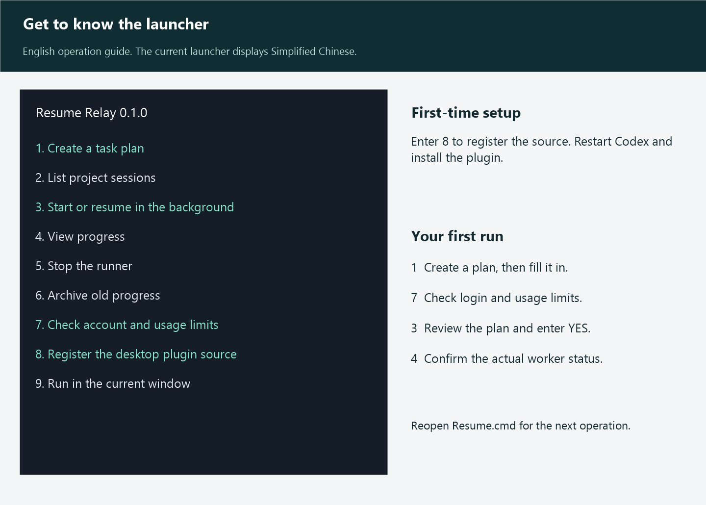
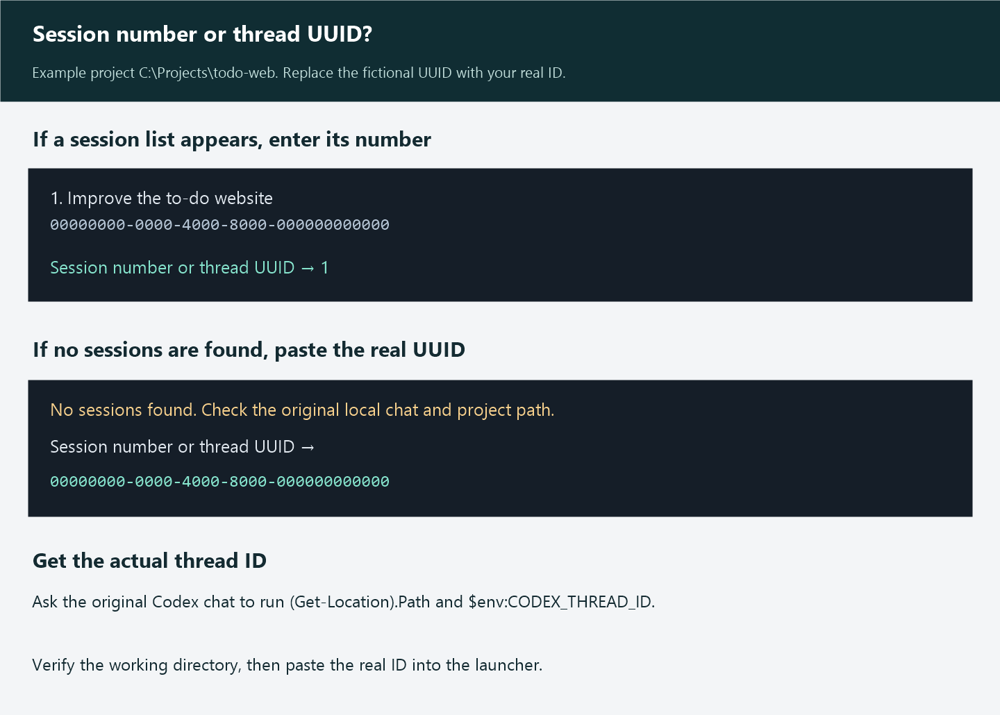
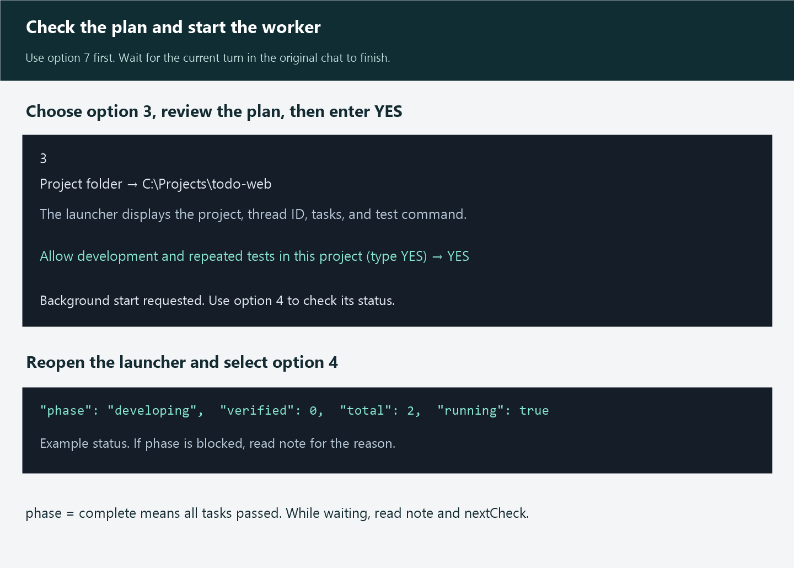

# Resume Relay · Windows

[简体中文](README.md) · [English](README.en.md) · [繁體中文](README.zh-TW.md) · [日本語](README.ja.md)

A Windows plugin and background runner for Codex. It waits for usage limits to reset, resumes the original local session, and works through a task checklist. It runs tests after each task, logs progress, and stops when all tasks pass.

The runner uses your existing ChatGPT login to query Codex usage limits and waits until the reported reset time before checking again. Each task advances when Codex reports that its acceptance criteria are met and the runner independently executes your approved test command successfully.

## Start here

You need the [Codex Windows app](https://learn.chatgpt.com/docs/windows/windows-app) signed in with ChatGPT, [Node.js 22 or later](https://nodejs.org/), and a project you can develop locally. Follow the tutorial once, then use option 3 to resume, 4 to check progress, and 5 to stop.

This tutorial uses a fictional to-do website called `todo-web`. Replace its paths, thread ID, and tasks with your own. **The current launcher uses Simplified Chinese.** Menu numbers are the same in every guide. The English illustrations explain those controls in English and use fictional data.

### 1. Download the runner and register the plugin

Download `codex-resume-0.1.0-windows.zip` from **Assets** on [GitHub Releases](https://github.com/GibouLJB/Resume-Relay/releases/latest). Extract it to a folder you will keep, such as `C:\Tools\Resume-Relay`, and double-click `Resume.cmd` inside that folder.



Enter `8` and press Enter to register the plugin source. Restart Codex, select **Resume Relay** in the plugin directory, and install **续程 · Codex 项目续跑**. Restart Codex after installing Node.js so it picks up the updated PATH.

The Windows launcher starts, resumes, and stops the background worker. The desktop plugin helps prepare the plan and read progress. To start background work, select option 3 in the launcher and confirm the plan.

### 2. Find the project folder and original chat

Suppose you have been developing a to-do website with Codex in this folder.

```text
C:\Projects\todo-web\
├── package.json
├── README.md
├── src\
└── test\
```

For this example, the project folder is `C:\Projects\todo-web`. Open that folder in File Explorer, click the address bar, and copy its full path.

| Item | What it means and where to find it |
| --- | --- |
| Project folder | The actual code directory used by the original Codex chat, usually the root containing the source, README, and project configuration |
| Original chat | The chat where you discussed and developed this project. Open it to obtain its ID |
| Session number | A temporary number on the left of the runner's session list, such as `1` or `2` |
| Thread UUID | The full chat identifier, such as `00000000-0000-4000-8000-000000000000`. Use your actual chat ID |

Send this prompt in the original Codex chat to obtain both values.

```text
Run these PowerShell commands and tell me the full current working directory and the current thread ID.

(Get-Location).Path
$env:CODEX_THREAD_ID

Label the project path and thread ID separately.
```

Use the actual path Codex returns. With a Git worktree, it may point to a separate worktree folder. Send at least one message in the local chat and wait for its current turn to finish before handing it to the runner. If the ID is empty, check whether that chat's execution environment exposes this variable.

### 3. Create a blank task plan

Double-click `Resume.cmd`, enter `1`, and press Enter. Paste the path from step 2 when prompted for the project folder (`项目文件夹`).

```text
Menu selection → 1
Project folder → C:\Projects\todo-web
```

Enter the full path explicitly. Leaving it blank uses the launcher's current directory.

If a session list appears, locate the chat by its title and enter the number on its left. For the following fictional entry, enter `1`.

```text
1. Improve the to-do website  00000000-0000-4000-8000-000000000000
```

**If you see “未找到会话” (no sessions found), there is no session number to select.** Paste the real UUID from step 2 and check the project path and signed-in account. The runner validates a manually entered UUID further when starting.



The runner creates `codex-resume.plan.json` in your project and reports `已创建空白清单` (blank plan created). Press any key to close the window. Double-click `Resume.cmd` again for your next operation.

**After creating the blank plan, fill it in.** The generated task title, acceptance criteria, and test command still need values.

### 4. Ask Codex to fill in the remaining work

Return to the original chat from step 2 and paste this prompt. If the plan file already exists, continue with this step.

```text
Fill in codex-resume.plan.json at the project root using our agreed project goals and current development progress.

Keep the existing version and threadId.
Put the remaining work in tasks. Give each task a unique id, a clear title, and verifiable acceptance criteria.
Inspect how this project runs tests, then set the test array to the correct executable and arguments.
Run that test command first, confirm it can execute, and report the actual result.
Ask me about any unresolved requirements that affect implementation.

When finished, explain the task list, test command, current test results, and whether the project is ready for the runner.
```

For a to-do website already configured to use Node.js's built-in test runner, the plan might look like this. Replace the sample thread ID and choose the actual test command for your project.

```json
{
  "version": 1,
  "threadId": "00000000-0000-4000-8000-000000000000",
  "tasks": [
    {
      "id": "add-todo",
      "title": "Finish adding to-do items",
      "acceptance": "Users can add an item by entering a title. Blank titles show a validation message. Add automated tests for valid and blank input."
    },
    {
      "id": "persist-todos",
      "title": "Persist to-do data",
      "acceptance": "Items and their completion states survive a page refresh. Add automated tests for saving and loading data."
    }
  ],
  "test": ["node.exe", "--test"],
  "maxAttempts": 4,
  "turnTimeoutMinutes": 90,
  "testTimeoutMinutes": 20
}
```

The first element of `test` is the executable. Each subsequent element is one argument. A pytest project can use `["python.exe", "-m", "pytest"]`. For Windows npm scripts, see the [packaged example plan](examples/codex-resume.plan.json).

Review the plan and make sure the tasks match your remaining work and the tests can detect real problems. Every task runs the same test command. The runner relies on Codex's assessment of the acceptance criteria and the test exit code, so completion depends on the quality of both.

### 5. Check login and usage limits

Reopen `Resume.cmd`, select `7`, and enter the same project path. Continue when it reports `ChatGPT 登录和额度查询正常` (ChatGPT login and quota query succeeded).

The check can succeed even when your quota is exhausted. The runner will wait according to the reported limits after starting. Resolve any login or interface errors shown before proceeding.

### 6. Start the background runner

Wait for the original chat's current turn to finish. Reopen `Resume.cmd`, select `3`, and enter the same project path. Review the displayed path, thread ID, tasks, and test command. Type uppercase `YES` and press Enter.



When you see `已提交后台启动请求` (background start requested), reopen the launcher and use `4` to check the actual status. The worker may encounter an account or session error during startup. Read `note` for the reason. For troubleshooting, option `9` runs in the current window and shows output directly.

Use another chat to query plugin progress while the runner is active. Before developing manually in the original chat, stop the runner with option `5` and use option `4` to confirm `running` is `false`.

Once background execution starts successfully, you can close the launcher and Codex. Keep Windows powered on, signed in, and awake. Work pauses during sleep and checks continue after waking. After a restart or sign-out, reopen the launcher and use option `3` to resume.

### 7. Check progress and completion

Reopen the launcher, choose `4`, and enter your project path. Alternatively, send this prompt in another Codex chat with the plugin installed, replacing the path.

```text
Use the Resume Relay plugin to check progress for C:\Projects\todo-web.
Tell me the current task, the number of verified tasks, whether the worker is running, and why it is waiting or stopped.
```

`verified` is the number of accepted tasks and `total` is the total number. For example, `verified: 1` and `total: 2` means one of two tasks has passed. Timestamps use ISO format. A trailing `Z` indicates UTC.

`phase: "complete"` means all tasks have passed and the worker has exited. For `phase: "waiting"` with `running: true`, read `note` and `nextCheck` for the reason and next check time.

## Menu reference

| Option | Meaning | When to use it |
| --- | --- | --- |
| `1` | Create a task plan | First-time project and chat selection |
| `2` | List project sessions | Find chat titles and IDs |
| `3` | Start or resume in the background | Begin or resume a prepared plan |
| `4` | View progress | Check whether work is running, waiting, or complete |
| `5` | Stop the runner | Pause work or take over manually |
| `6` | Archive old progress | Start a changed plan from its first task |
| `7` | Check account and quota access | Before starting or when troubleshooting login |
| `8` | Register the desktop plugin source | Initial plugin setup |
| `9` | Run in the current window | Watch development and test output |

## Plan fields and tests

| Field | Meaning |
| --- | --- |
| `version` | Currently `1` |
| `threadId` | UUID of the original local chat |
| `tasks` | 1–200 tasks executed in order, each with a unique `id`, `title`, and `acceptance` |
| `test` | An array containing the executable followed by individual arguments |
| `maxAttempts` | Completed development turns allowed per task, default 4, range 1–20. Quota interruptions do not count |
| `turnTimeoutMinutes` | Development turn timeout, default 90 minutes, range 1–360 |
| `testTimeoutMinutes` | Test timeout, default 20 minutes, range 1–120 |

Tests run in Codex's workspace sandbox. Prepare dependencies and confirm the test command works in your Windows sandbox setup. Run trusted project code. Network isolation depends on the configured Windows sandbox implementation. [Windows sandbox documentation](https://learn.chatgpt.com/docs/windows/windows-sandbox)

To change the thread, tasks, or test command in a previously started plan, stop the worker, archive progress with option 6, and review the new plan. Archiving restarts progress from the first task and preserves existing project edits.

## Status and troubleshooting

| Status | Meaning |
| --- | --- |
| `notStarted` | No saved run yet. Fill in the plan and start with option 3 |
| `queued` / `developing` / `testing` | Starting, developing, or testing |
| `waiting` | Waiting for a quota check or retrying a temporary service failure. `nextCheck` is the planned check time. When both quota windows are exhausted, the later reset applies |
| `complete` | Every task passed and the worker exited |
| `stopped` / `interrupted` | Stopped by the user or interrupted by process exit. Restart to load the checkpoint |
| `blocked` | Login, permissions, tests, session access, or another failure needs attention. Read `note` |

| Problem | Next step |
| --- | --- |
| No sessions found, but a number is requested | Obtain the real UUID in step 2 and paste it. Check the actual working directory, ChatGPT account, and local execution environment |
| Blank plan created. What next? | Follow step 4, review the filled plan, check with option 7, and start with option 3 |
| Plan already exists | Open and continue editing the existing file |
| Invalid task plan | Check for empty titles, acceptance criteria, or `test`, and make sure the file is valid JSON within the field limits above |
| Plan differs from the approved plan | Stop with 5, confirm exit with 4, and archive with 6. The new plan starts at its first task |
| Background start requested, but no work is running | Use 4 to inspect `phase`, `note`, and the log path. Use 9 to see errors directly |
| Development attempt limit reached | Inspect the original chat and test diagnostics. Fix the cause before restarting. The default is four completed development turns per task |

Progress and capped test output are stored at `%LOCALAPPDATA%\CodexResume\<project-key>\progress.jsonl`. Background output is in `worker.log` in the same folder. The plugin reads status summaries and log paths. Review logs before sharing because they may contain project content.

The runner finds `codex.exe` on PATH or in the Windows app package. Set `CODEX_RESUME_EXE` to an installed native executable's absolute path if needed. The desktop app and runner must share the chat's local Codex data directory and ChatGPT login. If the CLI starts but cannot find the chat, check the working directory, local versus cloud execution, and `CODEX_HOME`.

Quota handling follows App Server's reported windows. Unknown reset times are checked infrequently. Repeated quota rejections without an exhausted window have a retry limit. The tool uses the account's normal quota resets. [Codex App Server](https://learn.chatgpt.com/docs/app-server)

Organization policies, missing permissions, and interactive requests can stop work. Resolve the reported issue and resume with the same plan. Both components run as your Windows user and rely on Codex's managed policies and sandbox.

You can also use PowerShell directly.

```powershell
.\Resume.cmd install
.\Resume.cmd init 'C:\Projects\todo-web'
.\Resume.cmd background 'C:\Projects\todo-web'
.\Resume.cmd status 'C:\Projects\todo-web'
.\Resume.cmd stop 'C:\Projects\todo-web'
```

To uninstall, stop the worker, uninstall the plugin in Codex, and run `codex plugin marketplace remove codex-resume-tools` in PowerShell to remove the source. Logs and checkpoints remain in the local data folder above.

## Build and distribution

```powershell
node --test test/worker.test.mjs
.\scripts\package.ps1
```

The script creates a Windows ZIP and SHA-256 file in `dist`, including all README translations and illustrations. You can also register the repository with `codex plugin marketplace add GibouLJB/Resume-Relay`. Start the Windows worker with `Resume.cmd` from the same distribution.

Public directory submission of the local MCP component requires OpenAI eligibility approval, publisher information, clean-install testing, and review. GitHub Releases distribution is available independently. [Plugin packaging](https://developers.openai.com/plugins/build/plugins) · [Desktop-only submissions](https://developers.openai.com/plugins/deploy/desktop-only)

Windows startup, plugin source registration, sandbox command execution, and simulated quota recovery have been verified. Multi-day runs across live account quota resets remain unverified.
