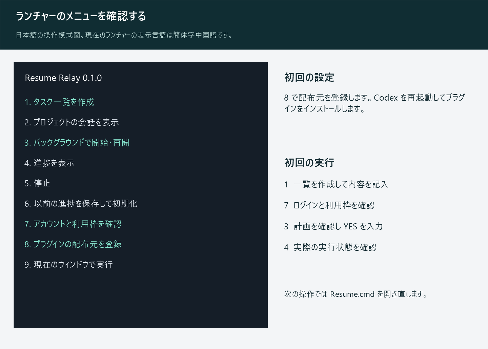
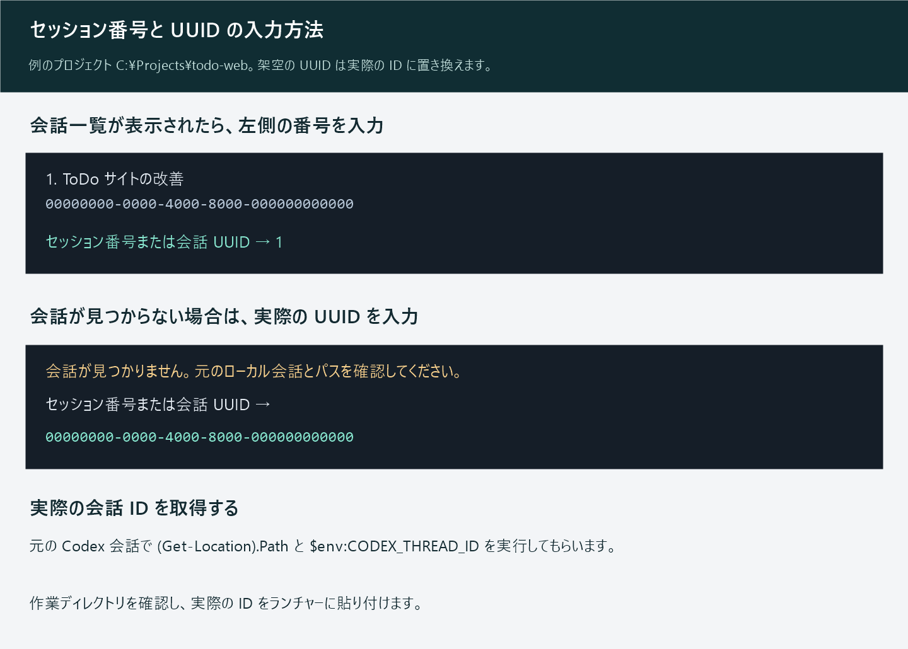
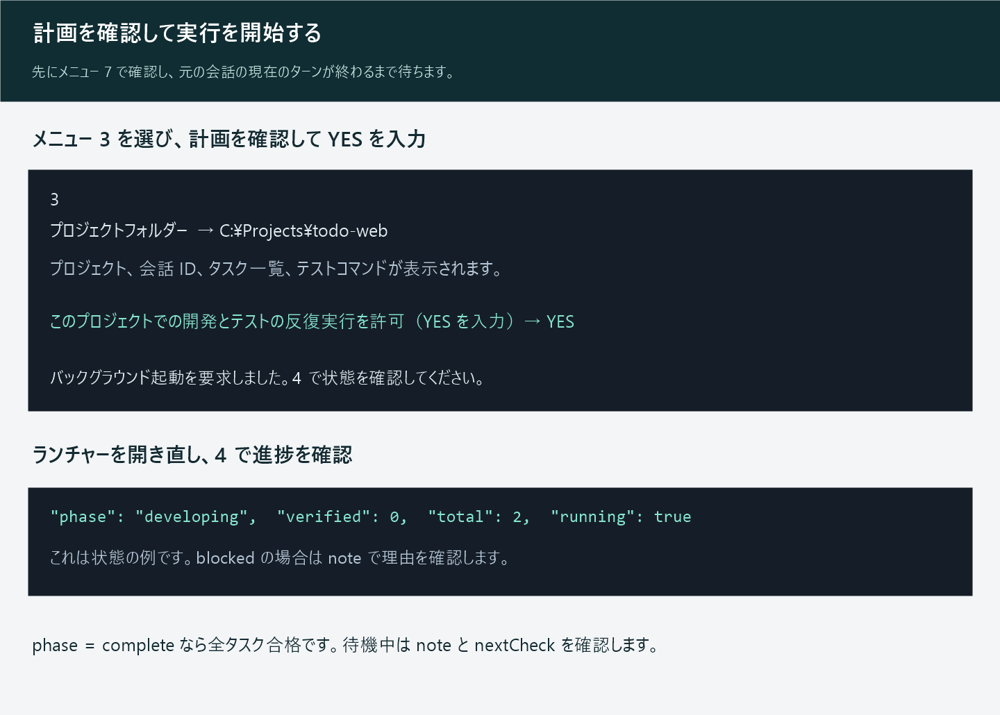

# Resume Relay · Windows

[简体中文](README.md) · [English](README.en.md) · [繁體中文](README.zh-TW.md) · [日本語](README.ja.md)

Codex のローカル開発を継続する Windows 用プラグインとバックグラウンド実行ツールです。利用上限に達するとリセットを待ち、元の会話を再開します。タスク一覧に沿って開発とテストを進め、進捗を記録し、すべてのタスクが合格すると自動的に終了します。

既存の ChatGPT ログインで Codex の利用枠を確認し、サーバーが返したリセット時刻に基づいて待機・再確認します。各タスクは、Codex が完了条件を満たしたと判断し、さらにツールが承認済みのテストコマンドを実行して成功した後に次へ進みます。

## 0.2.0 では会話から直接開始

[Windows 0.2.0 をダウンロード](https://github.com/GibouLJB/Resume-Relay/raw/refs/heads/main/downloads/v0.2.0/codex-resume-0.2.0-windows.zip) · [SHA-256](downloads/v0.2.0/codex-resume-0.2.0-windows.zip.sha256)

更新・再インストール後、対象プロジェクトのローカル Codex 会話で Resume Relay を指定し、計画作成、テストコマンドの検証、完了までのバックグラウンド実行を依頼してください。

Codex が resume_start を呼び出します。handoff は元の会話の現在のターンの終了待ちで、その後に同じ会話を再開します。別の会話から進捗確認、停止、再開ができます。初回の配布元登録は必要です。

resume_start と resume_stop を追加し、resume_status も使用できます。権限やアカウント、インターフェースの問題は理由を返します。引き継ぎはローカル App Server が保存したターン状態で確認します。実際のデスクトップ会話での一連の引き継ぎは未検証です。

以下の図解は手動操作の説明です。図は 0.1.0 のもので、メニュー番号は共通です。

### 0.1.0 から更新する

新版 ZIP を展開し、旧版の処理を停止します。新しい Resume.cmd のメニュー 8 で配布元を登録し、Codex を再起動してプラグインを更新または再インストールします。resume_start、resume_stop、resume_status が使えることを確認してください。

### 会話から実行する手順

1. 元のローカル会話で Resume Relay を指定し、目標と自動実行の希望を伝えます。
2. Codex が計画を記入し、テストコマンドを検証して resume_start を呼び出します。
3. Codex がターンを終了すると、処理が状態を確認して引き継ぎます。handoff は待機中、developing は開発中です。
4. 別の会話から確認、停止、再開を依頼します。計画の変更前に停止し、以前の進捗を保存してください。

## ランチャーの手動操作ガイド

ChatGPT でログイン済みの [Codex Windows アプリ](https://learn.chatgpt.com/docs/windows/windows-app)、[Node.js 22 以降](https://nodejs.org/)、ローカルで開発できるプロジェクトを用意してください。初回は以下の手順に沿って設定します。次回からは、メニュー 3 で再開、4 で進捗確認、5 で停止できます。

この手順では、架空の ToDo サイト `todo-web` を使います。パス、会話 ID、タスクは自分のものに置き換えてください。**現在のランチャーの表示言語は簡体字中国語です。** 各言語のガイドでメニュー番号は共通です。図は操作内容を日本語で説明した模式図で、データは架空のものです。

### 1. ダウンロードしてプラグインの配布元を登録する

[GitHub Releases](https://github.com/GibouLJB/Resume-Relay/tree/main/downloads/v0.2.0) のダウンロードフォルダーから `codex-resume-0.2.0-windows.zip` をダウンロードします。`C:\Tools\Resume-Relay` など、継続して使用するフォルダーに展開し、その中の `Resume.cmd` をダブルクリックしてください。



`8` を入力して Enter を押すと、プラグインの配布元が登録されます。Codex を再起動し、プラグイン一覧で **Resume Relay** を選び、**续程 · Codex 项目续跑** をインストールします。Node.js をインストールした直後は、更新された PATH を読み込むために Codex を再起動してください。

Windows ランチャーはバックグラウンド処理の開始・再開・停止を担当します。デスクトッププラグインはタスク一覧の準備と進捗確認を支援します。バックグラウンド処理は、ランチャーでメニュー 3 を選び、計画を確認すると開始します。

### 2. プロジェクトのパスと元の会話を確認する

Codex で開発中の ToDo サイトが次のフォルダーにあるとします。

```text
C:\Projects\todo-web\
├── package.json
├── README.md
├── src\
└── test\
```

この例で指定するプロジェクトフォルダーは `C:\Projects\todo-web` です。エクスプローラーでそのフォルダーを開き、上部のアドレスバーをクリックすると、フルパスをコピーできます。

| 確認する項目 | 意味と確認方法 |
| --- | --- |
| プロジェクトフォルダー | 元の Codex 会話が実際にコードを開発している場所。通常はソース、README、設定ファイルがあるルートフォルダー |
| 元の会話 | このプロジェクトの要件を相談し、開発を進めてきたチャット。その会話から ID を取得 |
| セッション番号 | ツールが会話を見つけた際に一覧の左側に表示する一時的な番号。例は `1`、`2` |
| 会話 UUID | 会話を識別する文字列。例は `00000000-0000-4000-8000-000000000000`。実際には元の会話の ID を使用 |

再開したい元の Codex 会話に、次のプロンプトを送信してください。

```text
次の PowerShell コマンドを実行し、現在の作業ディレクトリのフルパスと、現在の会話 ID を教えてください。

(Get-Location).Path
$env:CODEX_THREAD_ID

どちらがプロジェクトのパスで、どちらが会話 ID かを明記してください。
```

Codex が返した実際のパスを使用します。Git ワークツリーを使っている場合は、別のワークツリーフォルダーを指していることがあります。ローカル会話で少なくとも一度メッセージを送信し、現在のターンが終了してからツールに引き継いでください。ID が空の場合は、その会話の実行環境でこの変数を取得できるか確認してください。

### 3. 空のタスク一覧を作成する

`Resume.cmd` をダブルクリックし、`1` を入力して Enter を押します。「项目文件夹」と表示されたら、手順 2 で確認したパスを貼り付けます。

```text
メニューの選択 → 1
プロジェクトフォルダー → C:\Projects\todo-web
```

フルパスを明示的に入力してください。空欄の場合は、ランチャーの現在のディレクトリが使われます。

会話一覧が表示されたら、タイトルを確認し、続けたい会話の左側の番号を入力します。次の架空の例なら `1` です。

```text
1. ToDo サイトの改善  00000000-0000-4000-8000-000000000000
```

**「未找到会话」（会話が見つかりません）と表示された場合、選べる番号はありません。** 手順 2 で取得した本物の UUID を貼り付け、プロジェクトのパスとログイン中のアカウントを確認してください。手動入力した UUID は、実行開始時にさらに検証されます。



成功すると、プロジェクト内に `codex-resume.plan.json` が作成され、「已创建空白清单」（空の一覧を作成しました）と表示されます。何かキーを押すとウィンドウが閉じます。次の操作では `Resume.cmd` を開き直してください。

**空の一覧を作成したら、次は内容を記入します。** 作成直後のタスク名、完了条件、テストコマンドには入力が必要です。

### 4. 残りの作業を Codex に記入してもらう

手順 2 の元の会話に戻り、以下を送信します。ファイルがすでにある場合は、この手順から続けてください。

```text
合意済みのプロジェクト目標と現在の開発状況に基づき、プロジェクトルートの codex-resume.plan.json を記入してください。

既存の version と threadId は保持してください。
残りの作業を tasks に記入し、各タスクに一意の id、明確な title、検証可能な acceptance を設定してください。
このプロジェクトのテスト方法を確認し、正しい実行ファイルと引数を test 配列に設定してください。
先にそのテストコマンドを実行して、実行可能であることを確認し、実際の結果を報告してください。
実装に影響する未確定の要件があれば、先に私に確認してください。

記入後、タスク一覧、テストコマンド、現在のテスト結果、実行を開始できる状態かを説明してください。
```

Node.js 標準のテストランナーを設定済みの ToDo サイトなら、次のような計画になります。会話 ID は本物に置き換え、プロジェクトに合ったテストコマンドを指定してください。

```json
{
  "version": 1,
  "threadId": "00000000-0000-4000-8000-000000000000",
  "tasks": [
    {
      "id": "add-todo",
      "title": "ToDo の追加機能を完成させる",
      "acceptance": "タイトルを入力すると ToDo を追加できる。空のタイトルには案内を表示する。有効な入力と空の入力の自動テストを追加する。"
    },
    {
      "id": "persist-todos",
      "title": "ToDo データを保存する",
      "acceptance": "ページを再読み込みしても項目と完了状態が保持される。保存と読み込みの自動テストを追加する。"
    }
  ],
  "test": ["node.exe", "--test"],
  "maxAttempts": 4,
  "turnTimeoutMinutes": 90,
  "testTimeoutMinutes": 20
}
```

`test` の最初の要素は実行ファイルで、その後の要素はそれぞれ一つの引数です。pytest なら `["python.exe", "-m", "pytest"]` を指定できます。Windows の npm スクリプトについては、[同梱の計画ファイル例](examples/codex-resume.plan.json)を参照してください。

記入されたタスクが予定していた残作業に合い、テストが実際の問題を検出できることを確認してください。すべてのタスクで同じテストコマンドを実行します。次に進むかどうかは、Codex による完了条件の判断とテストの終了コードで決まるため、完了条件とテスト範囲が完了判定の信頼性に影響します。

### 5. ログインと利用枠を確認する

`Resume.cmd` を開き直し、`7` を選んで同じプロジェクトパスを入力します。「ChatGPT 登录和额度查询正常」（ログインと利用枠の照会に成功）と表示されたら次に進めます。

利用枠を使い切っていても照会自体は成功する場合があります。その場合は、開始後に返された利用枠の情報に従って待機します。ログインやインターフェースのエラーが表示された場合は、その原因を解消してください。

### 6. バックグラウンドで開始する

元の会話の現在のターンが終了するまで待ちます。`Resume.cmd` を開き直して `3` を選び、同じプロジェクトパスを入力します。表示されたパス、会話 ID、タスク一覧、テストコマンドを確認し、大文字の `YES` を入力して Enter を押します。



「已提交后台启动请求」（バックグラウンド起動を要求しました）が表示されたら、ランチャーを開き直し、`4` で実際の状態を確認してください。起動時のアカウントや会話の確認でエラーになる場合があります。理由は `note` に記録されます。調査には、現在のウィンドウで出力を確認できる `9` も使えます。

実行中の進捗は、別の会話からプラグインで確認してください。元の会話で手動開発を再開する場合は、先に `5` で停止し、`4` で `running` が `false` になったことを確認します。

バックグラウンド処理が正常に始まった後は、ランチャーと Codex を閉じても実行を続けます。Windows は電源を入れたまま、サインイン状態でスリープさせずに使用してください。スリープ中は処理が止まり、復帰後に確認を続けます。再起動やサインアウト後は、ランチャーを開き直し、`3` で再開してください。

### 7. 進捗と完了を確認する

ランチャーを開き直して `4` を選び、プロジェクトパスを入力します。または、プラグインが使える別の Codex 会話に、パスを置き換えて次のように送信します。

```text
Resume Relay プラグインで C:\Projects\todo-web の進捗を確認してください。
現在のタスク、検証済みタスク数、実行中かどうか、待機または停止の理由を教えてください。
```

`verified` は検証済みのタスク数、`total` は総タスク数です。`verified: 1`、`total: 2` なら二つのうち一つが合格しています。時刻は ISO 形式で、末尾の `Z` は UTC を表します。

`phase: "complete"` は、すべてのタスクが合格し、バックグラウンド処理が終了した状態です。`phase: "waiting"` かつ `running: true` の場合は、`note` と `nextCheck` で待機理由と次回確認時刻を確認できます。

## メニュー早見表

| 番号 | 操作 | 使用する場面 |
| --- | --- | --- |
| `1` | タスク一覧を作成 | 初回のプロジェクトと会話の選択 |
| `2` | プロジェクトの会話を表示 | 会話のタイトルと ID を探す |
| `3` | バックグラウンドで開始・再開 | 記入済みの計画を実行・再開 |
| `4` | 進捗を表示 | 実行中、待機、完了の確認 |
| `5` | 停止 | 一時停止や手動作業への切り替え |
| `6` | 以前の進捗を保存して初期化 | 変更した計画を最初のタスクから実行 |
| `7` | アカウントと利用枠を確認 | 開始前やログインの問題の調査 |
| `8` | プラグインの配布元を登録 | 初回のプラグイン設定 |
| `9` | 現在のウィンドウで実行 | 開発とテストの出力を直接確認 |

## 計画ファイルの項目とテスト

| 項目 | 用途 |
| --- | --- |
| `version` | 現在は `1` |
| `threadId` | 元のローカル会話の UUID |
| `tasks` | 1～200 件を順番に実行。それぞれ一意の `id`、`title`、`acceptance` を指定 |
| `test` | 実行ファイルと個別の引数を順に指定する配列 |
| `maxAttempts` | タスクごとの完了した開発ターン数の上限。既定 4、範囲 1～20。利用上限による中断は含まない |
| `turnTimeoutMinutes` | 開発ターンのタイムアウト。既定 90 分、範囲 1～360 |
| `testTimeoutMinutes` | テストのタイムアウト。既定 20 分、範囲 1～120 |

テストは Codex のワークスペース用サンドボックスで実行します。依存関係を準備し、使用中の Windows サンドボックス設定でテストできることを確認してください。信頼できるプロジェクトコードを実行します。ネットワーク分離の機能は、設定した Windows サンドボックスの実装に依存します。 [Windows サンドボックスの説明](https://learn.chatgpt.com/docs/windows/windows-sandbox)

開始済みの計画で会話、タスク、テストコマンドを変更する場合は、実行を停止し、メニュー 6 で以前の進捗を保存してから新しい計画を確認します。その後の進捗は最初のタスクから計算され、プロジェクト内の既存の変更は保持されます。

## 状態とトラブルシューティング

| 状態 | 意味 |
| --- | --- |
| `notStarted` | 実行記録がまだない。計画を記入して 3 で開始 |
| `queued` / `developing` / `testing` | 起動中、開発中、テスト中 |
| `waiting` | 利用枠の確認待ち、または一時的なサービス障害後の再試行待ち。`nextCheck` は次回確認予定時刻。両方の利用枠を使い切った場合は遅い方のリセット時刻を使用 |
| `complete` | すべてのタスクがテストに合格し、処理が終了 |
| `stopped` / `interrupted` | ユーザーが停止、またはプロセスが終了。再開時にチェックポイントを読み込む |
| `blocked` | ログイン、権限、テスト、会話へのアクセスなどに対応が必要。理由は `note` を参照 |

| 問題 | 対応 |
| --- | --- |
| 会話が見つからないのに番号を求められる | 手順 2 で本物の UUID を取得して貼り付ける。作業ディレクトリ、ChatGPT アカウント、ローカル実行環境を確認 |
| 空の一覧を作った後の操作が分からない | 手順 4 で Codex に記入を依頼。内容を確認し、7 でチェックして 3 で開始 |
| ファイルがすでに存在する | 既存の計画ファイルを開いて編集を続ける |
| 計画が無効 | タイトル、完了条件、`test` の空欄、JSON の構文、項目の範囲を確認 |
| 承認済みの計画と異なる | 5 で停止、4 で終了確認、6 で以前の進捗を保存。新しい計画は最初のタスクから実行 |
| 起動要求後も実行されない | 4 で `phase`、`note`、ログの場所を確認。必要に応じて 9 でエラーを直接確認 |
| 開発試行の上限に達した | 元の会話とテスト結果を確認し、原因を解消してから再開。既定はタスクごとに完了した開発ターン 4 回 |

進捗とサイズを制限したテスト出力は `%LOCALAPPDATA%\CodexResume\<project-key>\progress.jsonl` に保存されます。バックグラウンド出力は同じフォルダーの `worker.log` です。プラグインは状態の要約とログの場所を参照できます。ログにはプロジェクトの内容が含まれることがあるため、共有前に確認してください。

`codex.exe` は PATH または Windows アプリパッケージから検索します。必要に応じて `CODEX_RESUME_EXE` にインストール済みのネイティブ実行ファイルの絶対パスを指定してください。アプリとツールは、会話のローカル Codex データディレクトリと ChatGPT ログインを共有する必要があります。CLI が起動するのに会話が見つからない場合は、作業ディレクトリ、ローカル／クラウド実行、`CODEX_HOME` を確認します。

利用枠は App Server が返す実際の情報に基づいて判断します。リセット時刻が不明な場合は間隔を空けて再確認します。使い切った利用枠が報告されないまま要求が拒否され続ける場合、再試行回数には上限があります。アカウントの通常の利用枠リセットを使用します。 [Codex App Server](https://learn.chatgpt.com/docs/app-server)

組織のポリシー、権限不足、手動回答が必要な要求によって処理が停止することがあります。原因を解消後、同じ計画で再開してください。ツールとプラグインは現在の Windows ユーザーとして動作し、Codex の管理ポリシーとサンドボックスに従います。

PowerShell から直接実行することもできます。

```powershell
.\Resume.cmd install
.\Resume.cmd init 'C:\Projects\todo-web'
.\Resume.cmd background 'C:\Projects\todo-web'
.\Resume.cmd status 'C:\Projects\todo-web'
.\Resume.cmd stop 'C:\Projects\todo-web'
```

アンインストール時は、先に処理を停止して Codex のプラグイン一覧から削除します。続いて PowerShell で `codex plugin marketplace remove codex-resume-tools` を実行し、配布元を解除します。ログとチェックポイントは上記のローカルデータフォルダーに残ります。

## ビルドと配布

```powershell
node --test test/worker.test.mjs
.\scripts\package.ps1
```

スクリプトは `dist` に Windows ZIP と SHA-256 ファイルを作成します。各言語の README と図も含まれます。`codex plugin marketplace add GibouLJB/Resume-Relay` でリポジトリを配布元として登録することもできます。Windows の処理は、同じ配布パッケージの `Resume.cmd` から開始します。

ローカル MCP コンポーネントを公開プラグインディレクトリに提出するには、OpenAI による提出資格の承認、公開者情報、クリーンインストールの検証、審査が必要です。GitHub Releases は独立した配布方法として利用できます。 [プラグインのパッケージ化](https://developers.openai.com/plugins/build/plugins) · [デスクトップ専用プラグインの提出](https://developers.openai.com/plugins/deploy/desktop-only)

Windows での起動、配布元登録、サンドボックスでのコマンド実行、模擬的な利用枠の回復は検証済みです。実際のアカウントで複数のリセットをまたぐ数日間の連続実行は未検証です。
