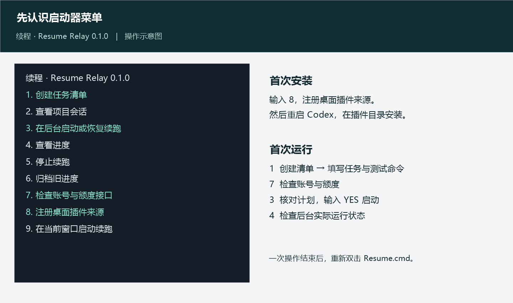
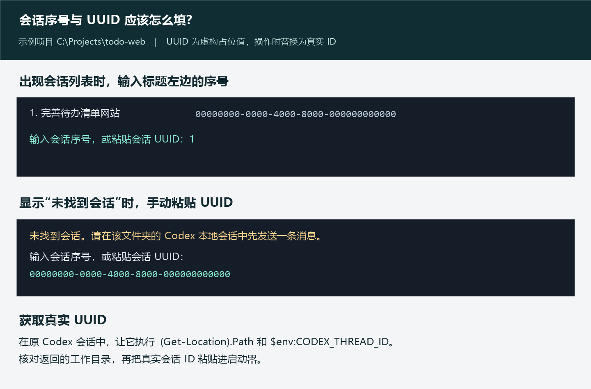
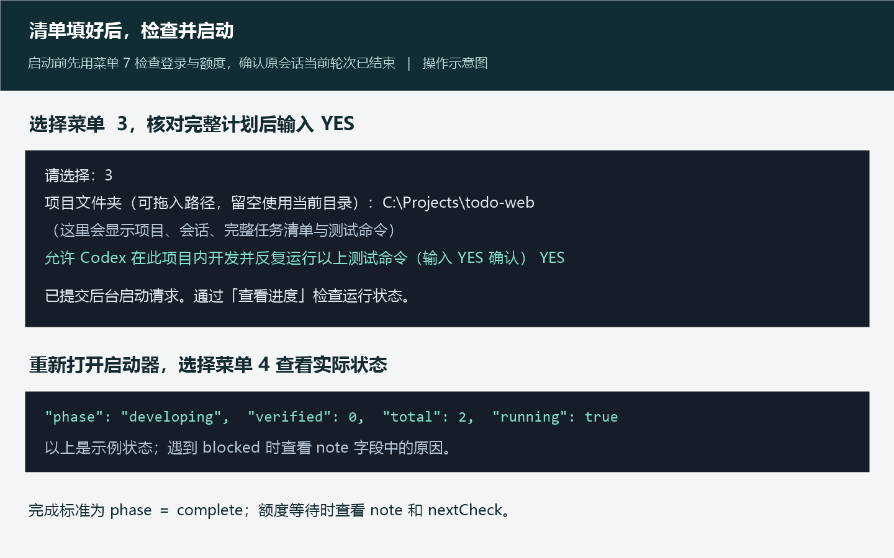

# 续程（Resume Relay）· Windows

A Windows plugin and background runner for Codex. It waits for usage limits to reset, resumes the original local session, and works through a task checklist. It runs tests after each task, logs progress, and stops when all tasks pass.

把已有 Codex 本地会话和一份开发清单交给 Windows 续跑器。它使用同一 ChatGPT 登录查询 Codex 额度，等待服务端报告的重置时间，再恢复原会话。每项任务都要由 Codex 报告可验收，并由续跑器独立运行你确认的测试命令。全部通过后后台进程自动退出。

## 从这里开始

准备好已登录 ChatGPT 的 [Codex Windows 客户端](https://learn.chatgpt.com/docs/windows/windows-app)、[Node.js 22 或更新版本](https://nodejs.org/)，以及一个能在本机继续开发的项目。首次使用按下面的案例走一遍，之后用菜单 3 恢复、菜单 4 查看进度、菜单 5 停止即可。

本文用虚构的待办清单网站 `todo-web` 演示。示例路径、会话 ID 和任务内容都需要换成自己的。配图为按当前启动器提示绘制的操作示意图。

### 1. 下载工具并注册插件

从 [GitHub Releases](https://github.com/GibouLJB/Resume-Relay/releases/latest) 的 **Assets** 下载 `codex-resume-0.1.0-windows.zip`，解压到准备长期保留的文件夹，例如 `C:\Tools\Resume-Relay`。在解压后的文件夹里双击 `Resume.cmd`。



输入 `8` 并回车，注册插件来源。重启 Codex，在插件目录选择 **Resume Relay**，安装 **续程 · Codex 项目续跑**。如果刚安装 Node.js，请重启 Codex，让客户端读取更新后的 PATH。

Windows 启动器负责启动、恢复和停止后台任务。桌面插件帮助准备任务清单、查询进度。后台运行需要先在启动器中选择菜单 3 并确认计划。

### 2. 找到项目路径和原会话

假设你已经在 Codex 中开发一个待办清单网站，文件夹结构如下。

```text
C:\Projects\todo-web\
├── package.json
├── README.md
├── src\
└── test\
```

这时要填的“项目文件夹”是 `C:\Projects\todo-web`。可以打开资源管理器中的项目文件夹，点击顶部地址栏，复制完整路径。

| 要找到的内容 | 含义与获取方法 |
| --- | --- |
| 项目文件夹 | 原 Codex 会话实际开发代码的目录。通常是包含源代码、README 和项目配置的根目录 |
| 原会话 | 你已经与 Codex 讨论需求并开发这个项目的聊天。打开这条聊天获取 ID |
| 会话序号 | 续跑工具找到会话后，列表左边的临时编号，例如 `1`、`2` |
| 会话 UUID | 标识聊天的完整字符串，例如 `00000000-0000-4000-8000-000000000000`。使用时填写原会话真实的 ID |

在准备续跑的那条 Codex 聊天里发送以下内容，可以同时确认路径和会话 ID。

```text
请执行以下 PowerShell 命令，告诉我当前工作目录的完整路径和当前会话 ID。

(Get-Location).Path
$env:CODEX_THREAD_ID

请分别标注哪个是项目路径、哪个是会话 ID。
```

使用 Codex 返回的实际路径。使用 Git 工作树时，该路径可能指向另一个工作树文件夹。先在本地会话中发送至少一条消息，并等本轮执行结束，再把会话交给续跑器。如果会话 ID 返回为空，请先确认当前聊天的执行环境支持读取该变量。

### 3. 创建空白任务清单

双击 `Resume.cmd`，输入 `1` 并回车。在“项目文件夹”处粘贴上一步确认的路径。

```text
请选择：1
项目文件夹（可拖入路径，留空使用当前目录）：C:\Projects\todo-web
```

建议明确填写完整路径。留空会使用启动器的当前目录。

如果出现会话列表，按标题找到要继续的那条聊天，输入它左边的序号。

```text
1. 完善待办清单网站  00000000-0000-4000-8000-000000000000
输入会话序号，或粘贴会话 UUID：1
```

**如果显示“未找到会话”，此时没有可选序号。** 可以粘贴步骤 2 获取的真实 UUID，并核对项目路径和登录账号。列表查找失败后，手动输入的 UUID 会在启动续跑时进一步验证。



成功后，会在所选项目里创建 `codex-resume.plan.json`，并显示“已创建空白清单”。按任意键后窗口关闭；下次操作需要重新双击 `Resume.cmd`。

**“已创建空白清单”后，下一步是填写清单。** 新文件里的任务标题、验收要求和测试命令都需要补齐。

### 4. 让 Codex 根据剩余工作填写清单

回到步骤 2 的原会话，粘贴下面的提示词。已有文件时直接继续这一步。

```text
请根据我们已经确定的项目目标和当前开发进度，填写项目根目录中的 codex-resume.plan.json。

保留现有 version 和 threadId。
将剩余开发工作写入 tasks，每项包含唯一 id、明确的 title 和可验证的 acceptance。
检查项目实际使用的测试方式，将正确的测试程序及参数写入 test 数组。
先运行这个测试命令，确认它能执行，并如实报告测试结果。
遇到尚未确定、会影响实施的需求，请先向我确认。

填写完成后，请向我说明任务清单、测试命令、当前测试结果，以及是否已经具备启动续跑的条件。
```

对于一个已经配置好 Node.js 内置测试的待办清单网站，填写后的清单可能如下。示例中使用的会话 ID 需要换成真实值，测试命令需要适合你的项目。

```json
{
  "version": 1,
  "threadId": "00000000-0000-4000-8000-000000000000",
  "tasks": [
    {
      "id": "add-todo",
      "title": "完成新增待办功能",
      "acceptance": "用户输入标题后可以新增待办；空白标题给出提示；补充新增和空白输入的自动化测试。"
    },
    {
      "id": "persist-todos",
      "title": "保存待办数据",
      "acceptance": "刷新页面后保留待办及其完成状态；补充保存和读取数据的自动化测试。"
    }
  ],
  "test": ["node.exe", "--test"],
  "maxAttempts": 4,
  "turnTimeoutMinutes": 90,
  "testTimeoutMinutes": 20
}
```

`test` 数组第一项是测试程序，后面每一项是一个参数。项目使用 pytest 时可填写 `["python.exe", "-m", "pytest"]`。使用 npm 脚本的 Windows 调用方式见 [发行包中的任务清单示例](examples/codex-resume.plan.json)。

看一遍 Codex 填写的清单，确认剩余工作符合预期，测试能发现项目中的实际问题。所有任务都会执行同一条测试命令。续跑器依据 Codex 对验收条件的判断和测试退出码决定是否推进，验收要求与测试覆盖会直接影响“完成”的可靠程度。

### 5. 检查登录和额度

重新双击 `Resume.cmd`，选择 `7`，填写同一个项目路径。看到“ChatGPT 登录和额度查询正常”即可继续。

额度已经耗尽时，查询仍可能正常完成，启动后续跑器会按实际额度等待。出现登录或接口错误时，先处理显示的原因。

### 6. 启动后台续跑

等原会话当前轮次执行结束。重新打开 `Resume.cmd`，选择 `3`，填写同一个项目路径。启动器会显示项目路径、会话 ID、全部任务和测试命令，核对后输入大写 `YES` 并回车。



看到“已提交后台启动请求”后，再重新打开启动器选择 `4` 查看实际状态。后台进程仍可能在检查账号或会话时遇到问题，具体原因会记录在状态的 `note` 中。首次排查时可以用菜单 `9` 在当前窗口运行，直接查看输出。

续跑期间，通过另一条聊天使用插件查询进度。如果要在原会话中手动继续开发，先用菜单 `5` 停止续跑，并通过菜单 `4` 确认 `running` 已变为 `false`。

后台模式启动成功后，可以关闭启动器和 Codex 客户端。电脑需要保持开机、用户登录且处于唤醒状态。睡眠期间暂停执行，唤醒后继续检查；重启或注销后，需要重新打开启动器，选择菜单 `3` 恢复。

### 7. 查看进度，确认完成

重新打开启动器，选择 `4` 并填写项目路径。也可以在安装了插件的另一条 Codex 聊天中发送以下内容，把路径换成自己的。

```text
请使用续程插件查看 C:\Projects\todo-web 的续跑进度。
告诉我当前任务、已通过验收的任务数量、是否正在运行，以及等待原因或停止原因。
```

状态中的 `verified` 表示已通过验收的任务数，`total` 表示总任务数。例如 `verified: 1`、`total: 2`，表示两项任务中已有一项通过。状态时间字段使用 ISO 格式，末尾为 `Z` 的时间按 UTC 显示。

看到 `phase: "complete"`，表示清单全部通过，后台进程结束。看到 `phase: "waiting"` 且 `running: true`，可以查看 `note` 和 `nextCheck` 了解等待原因与下次检查时间。其他状态见下表。

## 菜单速查

| 输入 | 操作 | 何时使用 |
| --- | --- | --- |
| `1` | 创建任务清单 | 首次选择项目和原会话 |
| `2` | 查看项目会话 | 查找该项目的聊天列表与 ID |
| `3` | 在后台启动或恢复续跑 | 清单已填写好，准备开始或恢复 |
| `4` | 查看进度 | 确认是否运行、等待或完成 |
| `5` | 停止续跑 | 准备手动接管或暂停开发 |
| `6` | 归档旧进度 | 更改已启动计划，准备从新清单第一项执行 |
| `7` | 检查账号与额度接口 | 首次启动前或排查登录问题 |
| `8` | 注册桌面插件来源 | 首次安装桌面插件 |
| `9` | 在当前窗口启动续跑 | 在窗口中观察开发与测试输出 |

## 清单字段与测试方式

| 字段 | 用途 |
| --- | --- |
| `version` | 当前为 `1` |
| `threadId` | 本地项目原始会话的 UUID |
| `tasks` | 1–200 项，顺序执行。每项包含唯一的 `id`、`title` 和 `acceptance` |
| `test` | 以数组明确指定可执行文件和参数。第一项为程序，后续为各个参数 |
| `maxAttempts` | 每项最多开发轮数，默认 4，可设 1–20。额度中断不占用开发轮数 |
| `turnTimeoutMinutes` | 单轮开发超时，默认 90 分钟，可设 1–360 |
| `testTimeoutMinutes` | 单次测试超时，默认 20 分钟，可设 1–120 |

测试示例包括 `["python.exe", "-m", "pytest"]` 或 `["node.exe", "--test"]`。对 npm 的 Windows 脚本，可参考示例中的 PowerShell 调用和退出码传播。续跑期间会使用 Codex 工作区沙箱执行，提前准备依赖并确认测试能在当前的 Windows 沙箱配置中运行。测试需要已有项目代码可信。网络隔离能力取决于配置的 Windows 沙箱实现。 [Windows 沙箱文档](https://learn.chatgpt.com/docs/windows/windows-sandbox)

改动已启动计划中的会话、任务或测试命令，需要先停止并用启动器「归档旧进度」，再审核新计划。归档后会按新清单从第一项开始，项目文件里的已有改动会保留。

## 状态和排障

| 状态 | 含义 |
| --- | --- |
| `notStarted` | 该项目还没有续跑记录，填写清单后用菜单 3 启动 |
| `queued` / `developing` / `testing` | 启动、开发或测试中 |
| `waiting` | 等待额度检查或临时服务错误退避，`nextCheck` 为预计检查时间。已耗尽的主、次窗口同时生效时，以较晚的重置时间为准 |
| `complete` | 所有任务均已通过测试，后台进程退出 |
| `stopped` / `interrupted` | 用户请求停止，或进程已意外退出。重新启动会读取本地检查点 |
| `blocked` | 需要处理登录、权限、测试、会话或其他失败，具体原因见 `note` |

| 遇到的问题 | 下一步 |
| --- | --- |
| 未找到会话，还在让输入序号 | 按教程步骤 2 获取原会话 UUID，手动粘贴。核对原会话的完整工作目录、ChatGPT 账号与本地执行环境 |
| 已创建空白清单，不知道下一步 | 按教程步骤 4，让原会话的 Codex 填写清单；审阅后用菜单 7 检查，再用菜单 3 启动 |
| 提示清单已经存在 | 打开原文件继续填写；首次创建步骤已完成 |
| 任务清单无效 | 检查标题、验收要求和 `test` 是否仍为空，以及文件是否为有效 JSON。字段范围见上表 |
| 提示计划与已批准计划不同 | 用菜单 5 停止，菜单 4 确认退出，再用菜单 6 归档旧进度。归档后会从新清单第一项执行 |
| 已提交后台启动请求，但没有运行 | 用菜单 4 查看 `phase`、`note` 和日志路径。必要时用菜单 9 查看错误 |
| 项目达到开发尝试上限 | 查看原会话和测试诊断，处理失败原因后重新启动。默认每个任务最多 4 个完成的开发轮次 |

- 进度和有上限的测试输出保存在 `%LOCALAPPDATA%\CodexResume\<项目标识>\progress.jsonl`，后台启动输出在同目录下的 `worker.log`。插件能读到状态概要和日志路径。日志可能包含项目内容，分享前先查看。
- 默认寻找 PATH 中的 `codex.exe`，也会查找 Windows 应用包中的 Codex。可用环境变量 `CODEX_RESUME_EXE` 指向已安装的原生 `codex.exe`。桌面端与续跑器必须共享这个会话的本地 Codex 数据目录和 ChatGPT 登录。
- 若 CLI 能启动但找不到会话，检查实际工作目录、本地和云端执行模式，以及是否使用了不同的 `CODEX_HOME`。工具只恢复能由本地 App Server 读取的会话。
- 额度按 App Server 返回的实际窗口判断，额度时间未知时低频复查。遇到额度拒绝但服务端没有报告耗尽窗口，退避重试有上限。工具不调用额度重置券接口。 [Codex App Server](https://learn.chatgpt.com/docs/app-server)
- 组织策略、缺失权限或需要手动回答的问题可能令任务停止。处理后使用同一清单恢复。插件和续跑器使用当前 Windows 用户运行，依赖 Codex 本身的企业管理策略和沙箱实现。

也可以在 PowerShell 里直接执行：

```powershell
.\Resume.cmd install
.\Resume.cmd init 'D:\My Projects\Example'
.\Resume.cmd background 'D:\My Projects\Example'
.\Resume.cmd status 'D:\My Projects\Example'
.\Resume.cmd stop 'D:\My Projects\Example'
```

卸载时，先停止任务，再在 Codex 插件目录卸载插件。从 PowerShell 运行 `codex plugin marketplace remove codex-resume-tools` 移除本地来源。日志和检查点仍可在上述本地数据目录查看。

## 构建和分发

```powershell
node --test test/worker.test.mjs
.\scripts\package.ps1
```

发布脚本在 `dist` 生成 Windows ZIP 和 SHA-256 校验文件。也可以通过 `codex plugin marketplace add GibouLJB/Resume-Relay` 注册插件来源。Windows 续跑器通过同一发行版的 `Resume.cmd` 启动。

正式上架通用插件目录时，本插件的本地 MCP 组件需要 OpenAI 批准提交资格，还需提交发布者资料、清洁安装结果和官方审查。GitHub Releases 安装路径可以独立使用。 [插件打包](https://developers.openai.com/plugins/build/plugins) · [桌面专用插件提交](https://developers.openai.com/plugins/deploy/desktop-only)

当前版本已验证 Windows 启动、插件来源注册、沙箱命令执行和模拟额度恢复。真实账号连续跨多个额度周期的多日运行仍待验证。
