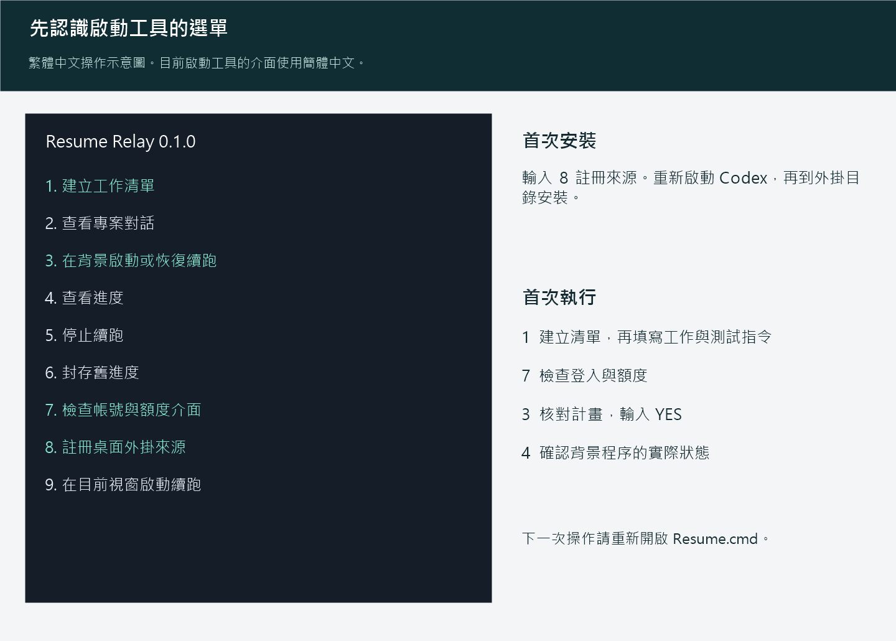
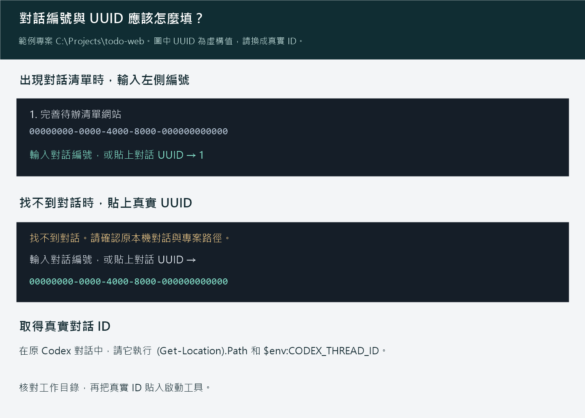
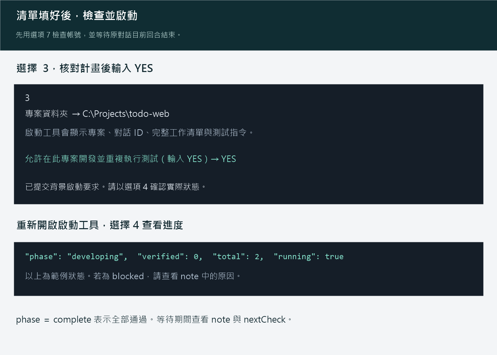

# 續程（Resume Relay）· Windows

[简体中文](README.md) · [English](README.en.md) · [繁體中文](README.zh-TW.md) · [日本語](README.ja.md)

供 Windows 使用的 Codex 外掛程式與背景執行工具。額度用盡後等待重設，再恢復原本的本機對話，依照工作清單繼續開發、執行測試並記錄進度。所有工作通過驗收後，背景程序自動結束。

工具使用既有的 ChatGPT 登入狀態查詢 Codex 額度，依照服務端回傳的重設時間等待並再次檢查。每項工作都要由 Codex 判斷符合驗收條件，再由工具獨立執行你確認的測試指令，測試通過後才會推進。

## 0.2.0 從聊天直接啟動

[下載 Windows 0.2.0](https://github.com/GibouLJB/Resume-Relay/raw/refs/heads/main/downloads/v0.2.0/codex-resume-0.2.0-windows.zip) · [SHA-256](downloads/v0.2.0/codex-resume-0.2.0-windows.zip.sha256)

更新並重新安裝外掛後，在目標專案的本機 Codex 對話中 @ 續程，請它根據目前進度建立清單、驗證測試指令，再直接啟動背景續跑直到完成。

Codex 會呼叫 resume_start。handoff 表示等待原對話目前回合結束，再接手同一對話。可在另一則聊天中查詢進度、停止或恢復。首次使用仍需註冊來源。

新增 resume_start 與 resume_stop，保留 resume_status。權限、帳號或介面錯誤會回報原因。交接使用本機 App Server 儲存的回合狀態，真實桌面對話的端到端交接仍待驗證。

以下圖文教學說明手動操作方式。配圖為 0.1.0，選單編號相同。

### 從 0.1.0 升級

解壓縮新版 ZIP，停止舊版程序，使用新版 Resume.cmd 選項 8 註冊來源。重新啟動 Codex 並更新或重新安裝外掛，確認 resume_start、resume_stop、resume_status 可用。

### 聊天操作流程

1. 在原本機專案對話中 @ 續程，說明目標並要求自動續跑。
2. Codex 填寫清單、驗證測試指令並呼叫 resume_start。
3. Codex 結束目前回合，背景程序確認狀態後接手。handoff 為等待交接，developing 為開發中。
4. 透過另一則聊天查詢、停止或恢復。修改已啟動計畫前，先停止並封存舊進度。

## 啟動工具手動操作教學

先準備已登入 ChatGPT 的 [Codex Windows 用戶端](https://learn.chatgpt.com/docs/windows/windows-app)、[Node.js 22 或更新版本](https://nodejs.org/)，以及可以在本機繼續開發的專案。首次使用請依照下方案例操作，之後用選項 3 恢復、4 查看進度、5 停止。

本文以虛構的待辦清單網站 `todo-web` 示範。範例路徑、對話 ID 與工作內容都需要換成自己的。**目前啟動工具的介面使用簡體中文。** 各語言教學的選項編號相同，繁體中文配圖用來說明對應操作，圖中資料均為範例。

### 1. 下載工具並註冊外掛來源

從 [GitHub Releases](https://github.com/GibouLJB/Resume-Relay/tree/main/downloads/v0.2.0) 的 **Assets** 下載 `codex-resume-0.2.0-windows.zip`，解壓縮至準備長期保留的資料夾，例如 `C:\Tools\Resume-Relay`。在解壓縮後的資料夾內，按兩下 `Resume.cmd`。



輸入 `8` 並按 Enter，註冊外掛來源。重新啟動 Codex，在外掛目錄選擇 **Resume Relay**，安裝 **续程 · Codex 项目续跑**。剛安裝 Node.js 時，請重新啟動 Codex，讓用戶端讀取更新後的 PATH。

Windows 啟動工具負責啟動、恢復與停止背景工作。桌面外掛協助準備工作清單及查詢進度。要開始背景執行，請先在啟動工具中選擇 3 並確認計畫。

### 2. 找到專案路徑與原對話

假設你已經使用 Codex 開發待辦清單網站，資料夾結構如下。

```text
C:\Projects\todo-web\
├── package.json
├── README.md
├── src\
└── test\
```

這個案例要填的專案資料夾就是 `C:\Projects\todo-web`。在檔案總管開啟該資料夾，點選上方的網址列，即可複製完整路徑。

| 要找的資料 | 意義與取得方法 |
| --- | --- |
| 專案資料夾 | 原 Codex 對話實際開發程式碼的目錄，通常包含原始碼、README 與專案設定 |
| 原對話 | 你已經與 Codex 討論需求並開發這個專案的聊天，從這則對話取得 ID |
| 對話編號 | 工具找到對話後，清單左側的暫時編號，例如 `1`、`2` |
| 對話 UUID | 識別聊天的完整字串，例如 `00000000-0000-4000-8000-000000000000`。操作時填入真實對話 ID |

在準備續跑的那則 Codex 對話中，傳送下列提示詞，同時確認路徑與對話 ID。

```text
請執行下列 PowerShell 指令，告訴我目前工作目錄的完整路徑，以及目前對話的 ID。

(Get-Location).Path
$env:CODEX_THREAD_ID

請分別標示哪一項是專案路徑、哪一項是對話 ID。
```

使用 Codex 回傳的實際路徑。使用 Git 工作樹時，路徑可能指向另一個工作樹資料夾。請先在本機對話傳送至少一則訊息，等目前回合執行完畢後再交給續跑工具。如果對話 ID 為空，先確認該對話的執行環境是否提供這個變數。

### 3. 建立空白工作清單

按兩下 `Resume.cmd`，輸入 `1` 並按 Enter。在「项目文件夹」提示處貼上步驟 2 確認的路徑。

```text
選擇選項 → 1
專案資料夾 → C:\Projects\todo-web
```

建議明確輸入完整路徑。留空時會使用啟動工具目前所在的目錄。

若出現對話清單，依標題找到要繼續的聊天，輸入左側編號。以下虛構範例應輸入 `1`。

```text
1. 完善待辦清單網站  00000000-0000-4000-8000-000000000000
```

**若顯示「未找到会话」，目前就沒有可選的編號。** 請貼上步驟 2 取得的真實 UUID，並核對專案路徑及登入帳號。手動輸入的 UUID 會在啟動續跑時進一步驗證。



成功後，工具會在所選專案內建立 `codex-resume.plan.json`，並顯示「已创建空白清单」。按任意鍵後視窗會關閉，下次操作請重新按兩下 `Resume.cmd`。

**建立空白清單後，接著要填寫內容。** 新檔案中的工作標題、驗收條件與測試指令都需要補齊。

### 4. 請 Codex 依照剩餘工作填寫清單

回到步驟 2 的原對話，貼上下列提示詞。檔案已存在時，可以直接從這一步繼續。

```text
請根據我們已經確定的專案目標與目前開發進度，填寫專案根目錄中的 codex-resume.plan.json。

保留現有的 version 和 threadId。
將剩餘開發工作寫入 tasks，每項包含唯一的 id、明確的 title，以及可驗證的 acceptance。
檢查專案實際採用的測試方式，將正確的測試程式及參數寫入 test 陣列。
先執行這個測試指令，確認它能執行，並如實回報測試結果。
遇到尚未確定、會影響實作的需求，請先向我確認。

填寫完成後，請說明工作清單、測試指令、目前測試結果，以及是否已具備啟動續跑的條件。
```

對於已設定好 Node.js 內建測試的待辦清單網站，清單可能如下。請換成真實對話 ID，並使用適合自己專案的測試指令。

```json
{
  "version": 1,
  "threadId": "00000000-0000-4000-8000-000000000000",
  "tasks": [
    {
      "id": "add-todo",
      "title": "完成新增待辦功能",
      "acceptance": "使用者輸入標題後可以新增待辦。空白標題顯示提示。補上新增與空白輸入的自動化測試。"
    },
    {
      "id": "persist-todos",
      "title": "儲存待辦資料",
      "acceptance": "重新整理頁面後保留待辦及完成狀態。補上儲存與讀取資料的自動化測試。"
    }
  ],
  "test": ["node.exe", "--test"],
  "maxAttempts": 4,
  "turnTimeoutMinutes": 90,
  "testTimeoutMinutes": 20
}
```

`test` 陣列第一項是測試程式，後面每項是一個參數。使用 pytest 的專案可以填 `["python.exe", "-m", "pytest"]`。Windows 上呼叫 npm 腳本的方式，請參考 [發行套件內的清單範例](examples/codex-resume.plan.json)。

請審閱 Codex 填好的清單，確認剩餘工作符合預期，測試也能找出專案中的實際問題。所有工作都執行同一個測試指令。工具依照 Codex 對驗收條件的判斷及測試結束代碼推進，因此驗收要求與測試涵蓋範圍會影響「完成」的可靠程度。

### 5. 檢查登入與額度

重新開啟 `Resume.cmd`，選擇 `7`，填入相同專案路徑。看到「ChatGPT 登录和额度查询正常」即可繼續。

額度已用盡時，查詢仍可能成功，啟動後工具會依實際額度等待。若顯示登入或介面錯誤，請先處理顯示的原因。

### 6. 在背景啟動續跑

等待原對話目前回合結束。重新開啟 `Resume.cmd`，選擇 `3`，填入相同專案路徑。啟動工具會顯示路徑、對話 ID、所有工作及測試指令，核對後輸入大寫 `YES`，再按 Enter。



看到「已提交后台启动请求」後，請重新開啟啟動工具，選擇 `4` 查看實際狀態。背景程序仍可能在檢查帳號或對話時遇到問題，原因記錄在 `note` 欄位。需要排查時，可以用 `9` 在目前視窗執行，直接查看輸出。

續跑期間，請透過另一則聊天使用外掛查詢進度。若要在原對話手動繼續開發，先以 `5` 停止，並用 `4` 確認 `running` 已變成 `false`。

背景模式成功啟動後，可以關閉啟動工具與 Codex。電腦需保持開機、使用者登入且處於喚醒狀態。睡眠期間暫停執行，喚醒後繼續檢查。重新開機或登出後，需要重新開啟啟動工具，選擇 `3` 恢復。

### 7. 查看進度並確認完成

重新開啟啟動工具，選擇 `4` 並填入專案路徑。也可以在已安裝外掛的另一則 Codex 聊天中傳送下列內容，將路徑換成自己的。

```text
請使用續程外掛查看 C:\Projects\todo-web 的續跑進度。
告訴我目前工作、已通過驗收的工作數量、是否正在執行，以及等待或停止的原因。
```

`verified` 是已通過驗收的工作數，`total` 是總工作數。例如 `verified: 1`、`total: 2`，表示兩項中已有一項通過。時間欄位使用 ISO 格式，結尾的 `Z` 表示 UTC。

`phase: "complete"` 表示全部工作通過、背景程序已結束。`phase: "waiting"` 且 `running: true` 時，可以查看 `note` 和 `nextCheck`，了解等待原因及下次檢查時間。

## 選單速查

| 選項 | 操作 | 使用時機 |
| --- | --- | --- |
| `1` | 建立工作清單 | 首次選擇專案與原對話 |
| `2` | 查看專案對話 | 查找聊天清單與 ID |
| `3` | 在背景啟動或恢復 | 清單已填好，準備開始或繼續 |
| `4` | 查看進度 | 確認執行、等待或完成狀態 |
| `5` | 停止續跑 | 暫停或手動接手 |
| `6` | 封存舊進度 | 修改已啟動的計畫，從新清單第一項執行 |
| `7` | 檢查帳號與額度介面 | 首次啟動前或排查登入問題 |
| `8` | 註冊桌面外掛來源 | 首次安裝外掛 |
| `9` | 在目前視窗啟動 | 直接觀察開發與測試輸出 |

## 清單欄位與測試方式

| 欄位 | 用途 |
| --- | --- |
| `version` | 目前為 `1` |
| `threadId` | 原本機對話的 UUID |
| `tasks` | 1–200 項，依序執行。每項包含唯一的 `id`、`title` 與 `acceptance` |
| `test` | 依序填入執行檔與個別參數的陣列 |
| `maxAttempts` | 每項最多完成的開發回合數，預設 4，範圍 1–20。額度中斷不計入 |
| `turnTimeoutMinutes` | 單次開發回合逾時，預設 90 分鐘，範圍 1–360 |
| `testTimeoutMinutes` | 單次測試逾時，預設 20 分鐘，範圍 1–120 |

測試在 Codex 工作區沙箱中執行。請先準備相依套件，確認測試能在目前的 Windows 沙箱設定中執行，並使用可信任的專案程式碼。網路隔離能力取決於 Windows 沙箱實作。 [Windows 沙箱文件](https://learn.chatgpt.com/docs/windows/windows-sandbox)

若修改已啟動計畫中的對話、工作或測試指令，請先停止，以選項 6 封存舊進度，再審閱新計畫。封存後會從第一項工作重新計算進度，專案檔案中的既有修改會保留。

## 狀態與疑難排解

| 狀態 | 意義 |
| --- | --- |
| `notStarted` | 尚無續跑紀錄。填好清單後，以選項 3 啟動 |
| `queued` / `developing` / `testing` | 啟動中、開發中或測試中 |
| `waiting` | 等待額度檢查或暫時服務錯誤後的重試。`nextCheck` 是預計檢查時間。主、次額度視窗都耗盡時，採較晚的重設時間 |
| `complete` | 全部工作通過測試，背景程序結束 |
| `stopped` / `interrupted` | 使用者停止或程序意外結束。重新啟動會讀取檢查點 |
| `blocked` | 登入、權限、測試、對話或其他錯誤需要處理，原因見 `note` |

| 遇到的問題 | 下一步 |
| --- | --- |
| 找不到對話，仍要求輸入編號 | 依步驟 2 取得真實 UUID 並貼上。核對完整工作目錄、ChatGPT 帳號與本機執行環境 |
| 建立空白清單後不知道怎麼繼續 | 依步驟 4 請原對話的 Codex 填寫，審閱後以 7 檢查、3 啟動 |
| 提示清單已存在 | 開啟既有檔案繼續編輯 |
| 工作清單無效 | 檢查標題、驗收條件與 `test` 是否為空，確認 JSON 格式及欄位範圍 |
| 計畫與已核准內容不同 | 以 5 停止、4 確認退出，再用 6 封存。新計畫將從第一項執行 |
| 已提交背景啟動要求，但沒有執行 | 用 4 查看 `phase`、`note` 與記錄路徑，必要時用 9 直接查看錯誤 |
| 達到開發嘗試上限 | 查看原對話與測試診斷，處理原因後重新啟動。預設每項最多完成 4 個開發回合 |

進度與有大小上限的測試輸出位於 `%LOCALAPPDATA%\CodexResume\<專案識別碼>\progress.jsonl`。背景輸出存於同目錄的 `worker.log`。外掛可以讀取狀態摘要與記錄路徑。記錄可能包含專案內容，分享前請先檢查。

工具會在 PATH 或 Windows 應用程式套件中尋找 `codex.exe`。必要時可用 `CODEX_RESUME_EXE` 指定已安裝原生執行檔的絕對路徑。桌面用戶端與工具必須共用對話的本機 Codex 資料目錄及 ChatGPT 登入狀態。CLI 能啟動卻找不到對話時，請檢查工作目錄、本機或雲端執行模式，以及 `CODEX_HOME`。

額度依 App Server 回傳的實際視窗判斷，重設時間未知時會低頻率重新檢查。服務持續拒絕請求卻未回報耗盡視窗時，退避重試有次數上限。工具使用帳號正常的額度重設機制。 [Codex App Server](https://learn.chatgpt.com/docs/app-server)

組織政策、缺少權限或需要手動回答的要求可能使工作停止。處理後以相同清單恢復。工具與外掛以目前 Windows 使用者身分執行，依賴 Codex 的管理政策與沙箱實作。

也可以直接在 PowerShell 執行。

```powershell
.\Resume.cmd install
.\Resume.cmd init 'C:\Projects\todo-web'
.\Resume.cmd background 'C:\Projects\todo-web'
.\Resume.cmd status 'C:\Projects\todo-web'
.\Resume.cmd stop 'C:\Projects\todo-web'
```

解除安裝時，先停止工作，再於 Codex 外掛目錄解除安裝。接著在 PowerShell 執行 `codex plugin marketplace remove codex-resume-tools` 移除來源。記錄與檢查點保留在前述本機資料目錄中。

## 建置與散布

```powershell
node --test test/worker.test.mjs
.\scripts\package.ps1
```

腳本會在 `dist` 產生 Windows ZIP 與 SHA-256 檔案，包含各語言 README 和配圖。也可以用 `codex plugin marketplace add GibouLJB/Resume-Relay` 註冊儲存庫來源。Windows 續跑程序透過同一發行套件內的 `Resume.cmd` 啟動。

正式上架公開外掛目錄時，本機 MCP 元件需要 OpenAI 核准提交資格，並提供發布者資料、乾淨環境安裝驗證及官方審查。GitHub Releases 可獨立作為散布管道。 [外掛封裝](https://developers.openai.com/plugins/build/plugins) · [桌面專用外掛提交](https://developers.openai.com/plugins/deploy/desktop-only)

目前已驗證 Windows 啟動、外掛來源註冊、沙箱指令執行及模擬額度恢復。真實帳號連續跨越多個額度週期的多日執行仍待驗證。
